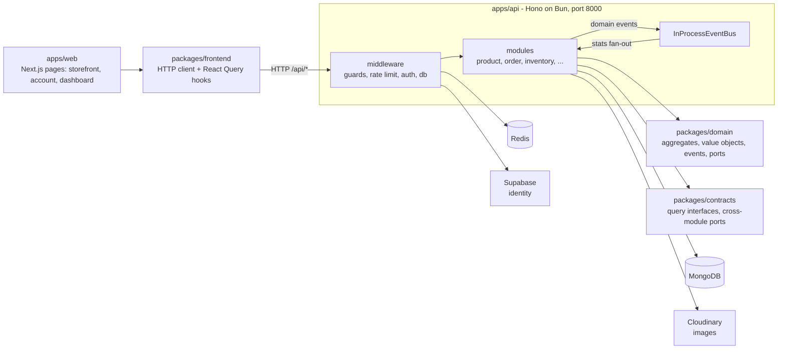
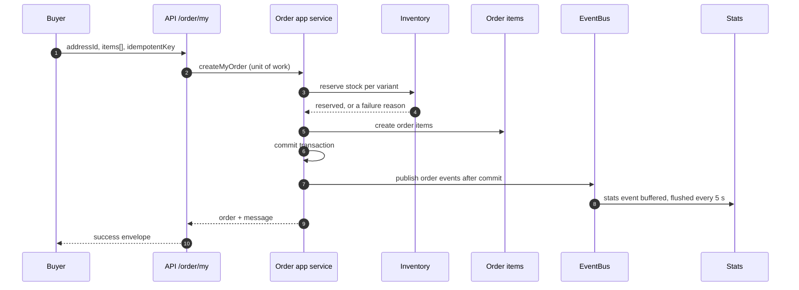
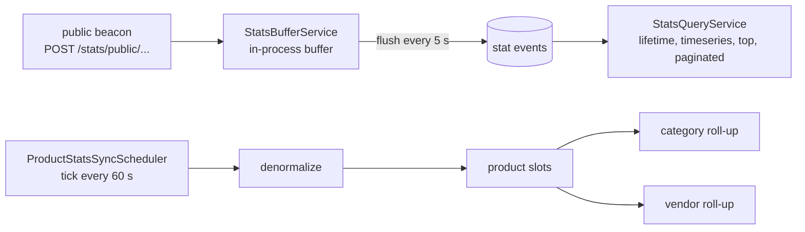

# Ecomerece

A multi-vendor marketplace: one Bun/Hono API backed by MongoDB, Redis, Supabase and Cloudinary, one
Next.js app that serves the storefront, the buyer account area and the admin/vendor dashboard, and a
headless TypeScript SDK shared by that app (and intended for mobile).

The backend is a DDD + CQRS + hexagonal codebase: every business module owns a pure domain layer,
a repository, an application service that orchestrates `load → mutate → save → publish`, and a thin
HTTP layer. Modules never import each other's internals — cross-module reads go through typed
contracts, reactions go through domain events.

The full, verified description of how the system behaves is
**[`PROJECT_DOCUMENTATION.md`](./PROJECT_DOCUMENTATION.md)**. This README is the entry point; the
document is the reference.

---

## What it is for

| Surface | Path prefix | Audience | Auth |
|---|---|---|---|
| Storefront | `/`, `/products`, `/categories`, `/vendors`, `/reviews` | anonymous visitors | none |
| Buyer account | `/account/**` | signed-in customers | Supabase session |
| Admin / seller dashboard | `/dashboard/**`, `/account/products`, `/account/vendor` | admins; vendors partially | Supabase session + API role checks |

What the system actually does:

- Buyers browse products by category or vendor, read and write reviews, keep an address book, hold a
  cart, and place orders. `POST /order/my` reserves stock through the inventory module, creates order
  items, and records stats — inside one transaction.
- Vendors create products and variants, manage stock and low-stock thresholds, set images,
  ingredients and disclaimers, answer reviews, and read their own sales stats (with a Redis-backed
  quota for forced refreshes).
- Admins moderate users (block/ban/soft-delete/recover), verify or reject vendors, block products
  and categories, moderate reviews, edit the home-page layout, and inspect the stats pipeline.
- Almost every "delete" is a soft delete with a matching recover endpoint; `deleted`, `blocked` and
  `banned` state is re-checked on every authenticated request.

---

## Repository layout

Bun workspaces monorepo.

```
.
├── apps
│   ├── api        Hono v4 API on Bun (port 8000)
│   ├── web        Next.js 16 App Router, Material UI (port 3000)
│   └── mobile     placeholder, contains no source files
├── packages
│   ├── domain     aggregates, value objects, events, ports, read models (pure TypeScript)
│   ├── contracts  the only cross-module surface: query interfaces, ports, actor types
│   ├── shared     Zod schemas, DTO types, response read models, stats types
│   └── frontend   headless SDK: HTTP client, React Query hooks, Zustand stores
├── postman        collections + environment (gitignored; pushed to a Postman workspace)
├── docs           architecture-guide.html, the step-by-step module playbook
├── ecosystem.config.js  pm2 production config (fork mode, Bun, port 8000)
└── PROJECT_DOCUMENTATION.md
```

Path aliases (root `tsconfig.json`): `@ecomerece/domain`, `@ecomerece/contracts`,
`@ecomerece/shared`, `@ecomerece/frontend`.

---

## Stack

| Concern | Choice |
|---|---|
| Runtime / package manager | Bun (runs TypeScript directly) |
| HTTP API | Hono v4 |
| Database | MongoDB via Mongoose 8 (transactions require a replica set) |
| Cache, counters, runtime settings | Redis (`redis` v6) |
| Identity | Supabase — JWT verification and Google OAuth |
| Validation | Zod 4 in `packages/shared` (shared by API and web forms) |
| Web | Next.js 16 App Router, React 19.3, Material UI |
| Client data layer | TanStack React Query 5 + Zustand 5 |
| Images | Cloudinary |
| Formatting | Biome (2 spaces, 100 cols, single quotes) |
| Linting | Next.js ESLint, `apps/web` only |
| Tests | `bun:test` |

---

## Getting started

Prerequisites: Bun, a MongoDB instance (replica set if you need transactions), Redis, and Supabase
credentials.

```bash
bun install           # install all workspace deps
bun run dev           # API on :8000 and web on :3000 together
bun run dev:api       # API only
bun run typecheck     # tsc --noEmit across workspaces
bun run lint          # Next.js ESLint (apps/web only)
bun run format        # Biome for apps/web and packages (not apps/api)
bun test              # test suite
bun run build         # build API, then next build
```

`.env` lives at the repo root and in `apps/api`; both are read by the API process.

### API environment

| Variable | Purpose |
|---|---|
| `MONGO_URI` | MongoDB connection; add `?replicaSet=rs0` for transactions |
| `REDIS_URL` | rate limiter, stats settings, vendor quota |
| `SUPABASE_URL` | auth middleware |
| `SUPABASE_SECRET_KEY` | service-role key used for server-side `getUser` (never ship to the client) |
| `CORS_ORIGIN` | comma-separated allowed origins |
| `RATE_LIMIT_WINDOW_MS`, `RATE_LIMIT_MAX` | rate limiter window and cap (default `60000` / `60`) |
| `IMAGE_STORAGE_PROVIDER` | selects the Cloudinary adapter |
| `CLOUDINARY_CLOUD_NAME`, `CLOUDINARY_API_KEY`, `CLOUDINARY_API_SECRET` | image uploads |
| `CLOUDINARY_SECURE`, `CLOUDINARY_FOLDER` | optional upload behaviour |
| `NOTIFICATION_CHANNELS` | extra delivery channels (e.g. `email`); the inbox is always written |
| `NOTIFICATION_EMAIL_TRANSPORT`, `NOTIFICATION_EMAIL_FROM` | email adapter: `console` (default) or `http`, plus sender |
| `NOTIFICATION_EMAIL_WEBHOOK_URL`, `NOTIFICATION_EMAIL_WEBHOOK_TOKEN` | HTTP email provider endpoint and optional bearer token |
| `NODE_ENV` | `production` hides error messages and stacks |
| `JWT_SECRET` | legacy from the pre-Supabase auth; not used for request verification |

### Web environment

| Variable | Purpose |
|---|---|
| `NEXT_PUBLIC_API_URL` | SDK base URL (default `/api`, same origin) |
| `API_PROXY_TARGET` | Next rewrite target (falls back to `NEXT_PUBLIC_API_URL`, then `http://localhost:8000`) |
| `NEXT_PUBLIC_SUPABASE_URL`, `NEXT_PUBLIC_SUPABASE_ANON_KEY` | browser Supabase client |

### Ports and proxying

The API always listens on `8000` (hardcoded in `apps/api/index.ts`); Next dev serves `3000`. The
browser never calls the API cross-origin in development: `apps/web/next.config.ts` rewrites
`/api/:path*` to the API, and the SDK's base URL defaults to `/api`. In production, run the API with
`pm2 start ecosystem.config.js` and deploy the web app with `next build` / `next start`; add the web
origin to `CORS_ORIGIN` only if it calls the API cross-origin.

---

## How a request flows

`apps/api/index.ts` mounts middleware in this exact order:

```
logger → secureHeaders → cors → requestGuards → rateLimiter → dbMiddleware
      → OPTIONS preflight → routes → error handler (onError + notFound)
```

`GET /health` is registered earlier, in `app.ts`, so it bypasses all of it and is safe for liveness
probes. `GET /stats/_health` reports how many stats events are buffered.

| Stage | What it does |
|---|---|
| `requestGuards` | caps URL/query/param length, body size, JSON depth and node count (`413`/`414` envelopes) |
| `rateLimiter` | Redis sliding-window counter keyed on `cf-connecting-ip` → `x-forwarded-for` → `unknown` |
| `dbMiddleware` | connects Mongoose once per process; requests get a `503` if MongoDB is down |
| `authMiddleware` | verifies the Supabase token, then loads the live user row (ban/block/delete, role) |
| `adminMiddleware` | requires `role === 'admin'` |
| `vendorMiddleware` | requires a signed-in owner of an active vendor; publishes the vendor id |

Ownership is checked twice on vendor routes: the middleware proves *which* vendor the caller owns, and
the application service re-checks that vendor against the concrete order, product, stock row or
review. That is why vendor routes carry no `:vendorId` parameter.

### Response contract

```jsonc
// success
{ "success": true, "data": { /* or { data: [...], meta: {...} } for lists */ } }

// failure
{ "success": false, "error": { "code": "VALIDATION_ERROR", "message": "…", "issues": [] } }
```

`ZodError` → 400 `VALIDATION_ERROR`; app errors keep their own status and code; Mongo duplicate key
→ 409 `CONFLICT`; Mongoose cast errors → 400 `INVALID_ID`; unmatched routes → 404 `NOT_FOUND`.

---

## Architecture

### How the pieces fit together



Only `packages/frontend` talks to the API, and only the API talks to the datastores. A module
reaches another module through `packages/contracts` or through an event on the bus, never by
importing its internals.

### Anatomy of a module

Per module, built bottom-up:

```
packages/domain/modules/<name>/      aggregate, value objects, events, ports (pure, no I/O)
packages/contracts/modules/<name>/   typed query interfaces + cross-module ports
apps/api/modules/<name>/
  infrastructure/                    Mongoose model, mapper, repository implementation
  application/                       app service (load → domain method → save → publish)
  presentation/                      controller (extends BaseController) + routes
  <name>.module.ts                   module factory: builds the graph, registers handlers
```

- `apps/api/composition-root.ts` is the single composition root. `createApplication()` builds the
  event bus, the unit of work and every module factory, then returns the graph; route files only
  receive controllers and declare URLs.
- Aggregates keep private state, expose intention methods and buffer events (`raise`), which the
  application service publishes only after the write commits.
- `OrderApplicationService.createMyOrder` is the deliberate exception: it runs inside a transaction
  and publishes order/order-item events after commit, so consumers never see a rolled-back write.
- Ids are always generated server-side (`Id.create()`, UUID v7); client-supplied ids are only used to
  address existing resources.
- Formatting is Biome; `bun run format` covers `apps/web` and `packages`, so format API files
  explicitly with `bunx biome format --write apps/api/modules/<name>/...`.

---

## API at a glance

268 routes across 18 prefixes, plus `/health`.

| Prefix | Routes | Audience split |
|---|---|---|
| `/product` | 24 | public reads, `/vendor`, `/admin` |
| `/product-variant` | 10 | public reads, `/vendor`, `/admin` |
| `/review` | 15 | public reads, `/my`, `/vendor`, `/admin` |
| `/product-inventory` | 15 | public variant availability, `/vendor`, `/admin` |
| `/order` | 23 | `/my`, `/vendor`, `/admin` |
| `/cart` | 5 | `/my`, `/admin` |
| `/order-items` | 18 | `/my`, `/vendor`, `/admin` |
| `/order-request` | 13 | `/my`, `/vendor`, `/admin` |
| `/shipping` | 27 | public tracking, `/my`, `/vendor`, `/admin` |
| `/return` | 19 | `/my`, `/vendor`, `/admin` |
| `/promotion` | 9 | `/validate` (auth), `/admin` |
| `/notification` | 5 | `/my` only — the inbox is personal |
| `/category` | 8 | public reads, `/admin` |
| `/address` | 8 | `/my`, `/admin` |
| `/users` | 14 | `/my`, `/admin`, plus `POST /users/init` |
| `/vendor` | 15 | public reads, `/me`, `/admin` |
| `/home` | 20 | public read, `/admin` |
| `/stats` | 20 | public beacons, `/vendor/me`, `/admin`, owner-or-admin entity reads |

The full per-route catalog, guard by guard, is §14 of `PROJECT_DOCUMENTATION.md`. Roles are
`customer`, `vendor` and `admin`; `PATCH /users/admin/role` is the only manual assignment.

### Core flows

- **Place an order** — `POST /order/my` validates the address and cart, asks inventory to reserve
  stock, creates order items, and commits; the stats module records the event. Vendor and admin
  command routes (`confirm`, `complete`, `return`, `refund`, `cancel`) act on the same aggregate.
- **Ship a parcel** — `POST /shipping/vendor` copies the buyer, delivery address and vendor split
  from the order through the order contract query, `PATCH /shipping/vendor/:id` attaches the label,
  and `dispatch → in-transit → out-for-delivery → deliver` records a scan per step. Buyers read only
  their own parcels; `GET /shipping/track/:trackingNumber` is public and withholds the address.
  Cancelling an order emits `order.cancelled`, and the shipping module reacts by cancelling its
  pending or dispatched parcels — delivered and returned parcels are left as they are.
- **Return an item** — `POST /return/my` checks the line through the order-items contract and the
  quantity against live requests, then the vendor approves, the buyer ships back and the vendor
  receives. Money movement is deliberately out of scope until payments exists.
- **Discount codes** — admins create percentage or fixed coupons with windows, caps and limits;
  `POST /promotion/validate` is a side-effect-free preview used by the cart. Redemption is exposed as
  `ICouponWriter` for checkout to call once its pricing accepts a discount.
- **Notifications** — the module subscribes to `order.created`, `order.cancelled`, three shipment
  events and three return events, resolves the recipient through the owner module's contract query,
  and writes an in-app inbox row; buyers list, count, read and dismiss their own. Email delivery is
  an opt-in channel adapter (`NOTIFICATION_CHANNELS=email`) — the inbox stays the source of truth.
- **Soft delete and recover** — most `DELETE` endpoints set `deleted` state; the paired `recover`
  route restores it. Moderation state (`blocked`, `banned`) is enforced by the auth middleware.
- **Stats pipeline** — public beacons (`/stats/public/...`) feed an in-process buffer that flushes
  every 5 s; a scheduler ticks every 60 s to refresh vendor stats; `POST /stats/admin/denormalize`
  rebuilds product slots, then rolls them up to categories and vendors. Settings live in Redis and
  are editable by admins.

**Order placement, end to end**



The publish happens after the commit, so a rolled-back order never emits events that inventory,
order-items or stats could act on.

**Stats pipeline**




---

## Frontend SDK and web app

`packages/frontend` is framework-agnostic and the only way `apps/web` talks to the API:

- `lib/http-client.ts` attaches the Supabase token, maps failures to `HttpError`, unwraps the
  response envelope, and returns `null` for `204`;
- `modules/<name>/*.service.ts` holds one method per API route; `*.hook.ts` wraps them in React Query;
- adapters (`auth`, `storage`, `theme`, `navigation`) have web and native implementations, selected by
  the `react-native` export condition.

`apps/web` is Next.js App Router with Material UI. All pages are client components hydrated through
React Query — there is no server-side data fetching. `RequireAuth` guards `/account/**` and
`/dashboard/**`; role checks are enforced by the API, not the client.

---

## Tests and checks

```bash
bun test                     # bun:test suite
bun test <path>              # one area, e.g. bun test apps/api/modules/stats
bun run typecheck            # tsc --noEmit
bun run lint                 # apps/web only
```

Coverage concentrates on domain behaviour (value objects, aggregates, stats fan-out and
denormalization) and order/order-items/inventory application logic. There is no HTTP integration
harness and no test database.

Known pre-existing failures: `bun run arch` points at a missing `scripts/arch-check.ts`, and
`bun run typecheck` fails on `apps/api/index.ts` (`CORS_ORIGIN` possibly `undefined`). Both predate
current feature work — see §22 of the documentation.

---

## API contract in Postman

`postman/` holds one collection per module (19 collections, 270 requests) plus an environment, and is
pushed to the bound Postman workspace:

```bash
postman workspace lint                     # validate local collections
postman workspace push -m "what changed"    # publish to the workspace
postman workspace diff                      # local vs cloud drift
```

The API route files are the source of truth; the collections and the SDK must match them. The rules,
and the run pitfalls (empty tokens → 401, placeholder ids → domain 404s, the 60 req/min limiter,
`reusePort` sharing `:8000` with a stale server), are in §8.7 of the documentation. Note that
`postman/` is gitignored, so collection changes are reviewed in the workspace rather than in PRs.

---

## Documentation map

| File | Contents |
|---|---|
| [`PROJECT_DOCUMENTATION.md`](./PROJECT_DOCUMENTATION.md) | the authoritative description: pipeline, auth, module catalog, every endpoint, stats subsystem, known gaps |
| [`docs/architecture-guide.html`](./docs/architecture-guide.html) | step-by-step playbook for building a module in this style |
| [`AGENTS.md`](./AGENTS.md) | commands, boundaries and hard stops for contributors and agents |
| [`LICENSE`](./LICENSE) | MIT |
